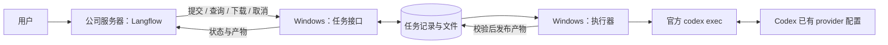

# Windows Codex 远程翻译任务服务 Spec

- 版本：0.2（2026-11-04 按用户确认调整配置归属）
- 日期：2026-11-03（Asia/Shanghai）
- 状态：**用户已于 2026-11-03 确认，开始实现；实际部署与模型验收另行记录。**
- 项目：`codex-remote-worker`

2026-11-04 联调补充：用户明确接受本次公网 HTTP 明文试跑。Langflow 节点提供默认关闭的“临时允许明文 HTTP”开关，仅在此次测试配置中开启；正式接入仍使用 HTTPS 或受保护通道。早期联调节点默认只检查连接；现已按下述自动模式修订。

2026-11-04 配置归属修订：用户明确要求 Langflow 只调用 Codex，并选择“直接沿用 Windows 上 Codex 的现有配置”。本版取代 0.1 的客户端传模型 ID、服务端模型允许列表和强制 OpenRouter 配置方案。模型、provider、推理强度、搜索与认证由远端 Codex 配置决定；请求只携带文件和执行时限。运行隔离、取消和交付检查保持由 Worker 管理。

2026-11-04 交付修复补充（0.2.1）：Windows 读取宿主 JSON 显式使用 UTF-8；宿主意外异常保留不含局部变量及原始错误文本的类型/阶段/代码位置。提供管理员本地 `recheck --job-id` 命令，仅对 Codex 已正常完成但宿主检查或发布失败的任务重新校验已有文件；要求停止 Worker 并确认原进程停止，记录原错误与恢复时间，不重新执行模型、不放宽文件与 QA 校验。HTTP 接口和 Langflow 节点不变。

2026-11-04 操作简化：默认自动运行，连接检查并入新任务提交前，查询合并为再次运行。高级设置保留重新翻译、取消任务和检查连接。同输入已完成时明确复用结果，执行失败不自动重跑；提交响应不确定时保留原提交编号。此改动仅涉及 Langflow 调用节点，不修改 Worker HTTP 协议。

## 1. 要解决的问题

公司服务器已经部署 Langflow，但不能在该服务器安装或运行 Codex。用户希望继续使用官方 Codex harness 自主处理翻译，并通过 OpenRouter 提供模型资源。

本项目把 Codex 执行放到**另一台允许部署它的 Windows 服务器**。公司 Langflow 通过 HTTP 接口提交任务、查询进度和取回文件。个人电脑仅用于开发，不是正式执行节点。

交付目标是：用户上传原文件、Prompt 和资料，调用远端 Codex，获得可下载的译文、检查报告和执行记录。接入成功不等于语言质量通过，使用同一 harness 也不保证原 Trace 的工具调用顺序或译文逐字一致。

## 2. 首版决策与范围

| 项目 | 首版方案 |
| --- | --- |
| 部署 | 一台独立 Windows 执行服务器；目标 Windows 版本和后台账户待部署前核实 |
| 规模 | 一个可信 Langflow 调用方，单租户，一次执行一个任务；最多排队 10 个 |
| harness | 调用固定版本的官方 `codex exec`，暂不迁移 Codex SDK |
| 模型 | 使用 Windows 服务运行账户已有的 Codex 默认配置；Langflow 不选择或传递模型 |
| 调用协议 | HTTP 异步任务接口；网络入口使用公司允许的 HTTPS 或受保护通道 |
| 技术组成 | Python HTTP 应用、SQLite 任务记录、本地磁盘任务目录、串行执行器 |
| 首个业务案例 | Siemens 英文到简体中文；XLSX/CSV 输入，CSV 输出 |
| Prompt | 上传的 UTF-8 Prompt 原始字节直接写入 Codex 标准输入 |
| Langflow | 提供远程调用节点源码与导入文件；公司服务器不安装 CLI/SDK |

明确不属于首版：通用远程命令接口、任意脚本上传执行接口、多机调度、多租户安全隔离、执行中聊天或审批界面、自动改写 Prompt、自动更换模型、自动重跑失败翻译、官方 Agents API、桌面客户端功能复刻。

Windows 是正式部署目标。开发机可以运行纯逻辑和模拟测试，但这些测试不能代替 Windows 实机验收；不同时承诺 Linux 正式部署支持。

## 3. 部署与职责



### 3.1 Langflow 调用模块

- 沿用上传入口，发送文件内容及原文件名，不能仅发送公司服务器本地路径。
- 提交、保存任务编号、查询状态、取回产物，并发布为 Langflow 可访问的下载文件。
- 保存业务提交编号与远端 `job_id` 的关联；查询和恢复不能重新创建翻译任务。
- 维护 Langflow 当前用户的文件访问限制；远端服务令牌不向普通终端用户暴露。
- 不知道也不接收 Windows CLI 安装路径、进程 PID 或本地磁盘绝对路径。

### 3.2 Windows 任务模块

- 对调用方鉴权，校验并保存输入，持久化任务状态，控制排队、时限和取消。
- 管理任务独立目录，生成受控的 Codex 调用参数，记录运行配置与事件。
- 检查真实产物，发布稳定的产物编号和校验值。
- HTTP 请求结束、Langflow 页面关闭或网络断开，不自动取消已接受的任务。

### 3.3 Codex 执行模块

- 在任务工作区内自主读取用户资料、翻译、使用已启用的工具并生成文件。
- 翻译决策由 Codex 与用户选择的模型完成；任务管理、文件完整性和发布由固定程序负责。
- 首版复用现有 `create_job`、Prompt 传入、公开事件过滤和 `collect_result` 的设计；需要迁移代码进入本仓库，不能在生产依赖开发机绝对路径。

## 4. 输入、Prompt 与输出约定

### 4.1 四份输入

| 上传字段 | 文件类型 | 必填 |
| --- | --- | --- |
| `source_file` | `.xlsx` 或 UTF-8 `.csv` | 是 |
| `prompt_file` | UTF-8 `.md` 或 `.txt` | 是 |
| `project_style` | `.md`、`.txt`、`.docx`、`.doc` | 是 |
| `general_style` | `.md`、`.txt`、`.docx`、`.doc` | 是 |

首版只接受单工作表 XLSX 或单 CSV，源文列为 `en`，目标列为 `zh-CN`。原表已有目标列则回填；没有则按现有案例约定追加该列。其他字段及行顺序保持不变。不支持宏工作簿或压缩包上传。

文件名只允许安全的 basename：拒绝路径穿越、绝对路径、Windows 保留名、备用数据流、尾随空格/点、大小写不敏感的重名，以及 `AGENTS.md`、`AGENTS.override.md` 等自动指令文件名。保留文件原名；不能悄悄覆盖重名资料。

### 4.2 Prompt 原文要求

1. Prompt 必须非空且可按 UTF-8 解码；保留 BOM、换行和前后空格。
2. 原始字节写入 stdin，不作为 shell 命令参数拼接。
3. 不添加角色设定、术语结论、翻译步骤、输出 JSON 模板或其他业务指令。
4. 不在工作区生成额外 `AGENTS.md`、任务指令或要求 Agent 执行的 QA Prompt。
5. 沙箱、超时、模型和文件访问约束在运行配置中实现。
6. 记录原 Prompt 的 SHA-256 和发送字节数，以便与原会话输入核对。

以上要求不表示删除 Codex 自身的基础指令，也不表示能够复制桌面端全部上下文。

### 4.3 产物约定

- 本案例期望文件名：`<原文件 stem>_ZH-CN.csv`。
- 在任务工作区内查找唯一同名文件；不要求用户修改 Prompt 指定固定子目录。
- 拒绝工作区外路径、符号链接或 Windows reparse point 越界，以及多个同名候选。
- 输入原件保存在执行器不可修改的区域；工作区使用副本，结束后核对副本哈希。
- 发布前复制到受控产物区并校验，接口只返回产物 ID，不暴露任意本地路径。
- 返回译文 CSV、`qa.json`、`run.json`、经过过滤的 `trace.jsonl`、最终公开回复与脱敏错误日志；实际存在的文件才进入清单。
- `completed` 表示文件交付与程序检查通过；语言质量字段固定说明尚未独立审校，不暗示客户验收。

## 5. HTTP 接口

除最小存活检查外，所有接口都要求 `Authorization: Bearer <SERVICE_TOKEN>`。服务访问令牌与 OpenRouter API Key 是两种不同凭据。

| 方法与路径 | 作用 | 成功响应 |
| --- | --- | --- |
| `GET /healthz` | 仅返回进程存活状态，不暴露配置 | `200` |
| `GET /v1/ready` | 检查本地依赖、配置、磁盘和执行器状态，不调用模型 | `200` 或 `503` |
| `POST /v1/jobs` | 持久化资料并创建任务 | 新任务 `202`；已存在的相同提交 `200` |
| `GET /v1/jobs/{job_id}` | 查询状态、进度摘要、问题与产物清单 | `200` |
| `GET /v1/jobs/{job_id}/artifacts/{artifact_id}` | 下载已发布的指定产物 | `200` |
| `POST /v1/jobs/{job_id}/cancel` | 请求取消，不删除证据 | 已终态 `200`；取消处理中 `202` |

### 5.1 创建任务

使用 `multipart/form-data`：四个文件 part，加一个 JSON 文本 part `options`。请求必须携带 `Idempotency-Key`，首版要求为 UUID。

```json
{
  "timeout_seconds": 1800
}
```

- `options` 可以为 `{}`，使用默认执行时限。
- 不接收 `model_id`、`reasoning_effort`、`web_search`。旧版调用方传入这些字段时返回 `422 INVALID_OPTIONS` 并提示更新节点。
- `timeout_seconds` 默认 1800，允许 60–7200；指任务开始执行到产物发布的总时限，排队时间单独记录。
- 不接受 CLI 路径、shell 命令、任意 `-c` 参数、任意 provider URL、客户端指定的服务器输出路径或 API Key。

```json
{
  "job_id": "job_example",
  "status": "queued",
  "reused": false,
  "status_path": "/v1/jobs/job_example",
  "poll_after_seconds": 3
}
```

响应只使用相对接口路径，由 Langflow 组合已配置的服务基址。

### 5.2 防止重复执行

- 资料先写暂存目录，完成校验和哈希计算后再持久化任务记录；接受成功后才进入队列。
- 在同一可信调用方范围内，同一 `Idempotency-Key` 加同一输入内容和规范化 options，返回原任务，不启动第二次翻译。
- 同一 key 携带不同资料、文件名或 options，返回 `409 IDEMPOTENCY_CONFLICT`。
- 客户端生成 key 后必须保存，网络重试沿用；用户主动重新试跑使用新 key。
- 文件内容相同不等于同一次提交，不据此自动复用旧译文。
- 幂等保证适用于记录保留期间。它不代表模型和工具操作在所有崩溃窗口都能做到 exactly-once。

### 5.3 查询任务

```json
{
  "job_id": "job_example",
  "status": "needs_review",
  "stage": "delivery_check",
  "progress": {"event_count": 28, "last_activity_at": "2026-11-03T10:00:00Z"},
  "error": null,
  "qa": {"rows": 128, "errors": 0, "warnings": 1},
  "language_quality": "not_independently_verified",
  "artifacts": [
    {
      "id": "artifact_example",
      "kind": "translation",
      "filename": "Siemens_doc_ZH-CN-0910_ZH-CN.csv",
      "bytes": 12345,
      "sha256": "<实际文件哈希>",
      "download_path": "/v1/jobs/job_example/artifacts/artifact_example"
    }
  ]
}
```

示例值不代表已完成试跑。进度展示执行阶段、事件数和最后活动时间；不根据模型字数推测虚假的完成百分比。

错误统一返回 `error.code`、面向用户的 `error.message` 和可用时的 `job_id`。至少区分：认证失败、输入无效、重复提交冲突、队列满、资源不足、环境未就绪、模型执行失败、超时、进程回收失败、产物无效。

HTTP 层采用：`401` 认证失败、`404` 不存在或不可访问、`409` 冲突、`413` 过大、`422` 输入或配置组合无效、`429` 队列满、`503` 未就绪/磁盘不足。任务已接受后的执行错误通过任务状态返回；不把上游错误文本中的凭据或内部路径原样透出。

## 6. 生命周期、取消与重启

主路径：`queued → running → checking → completed / needs_review / failed`。

| 状态 | 含义 |
| --- | --- |
| `queued` | 输入已保存并接受，尚未启动 Codex |
| `running` | 执行器已认领并开始处理；Codex 启动情况另有记录 |
| `checking` | Codex 已结束，正在验证并发布产物 |
| `cancelling` | 已请求取消，尚未确认进程树停止 |
| `completed` | 结构与固定程序检查通过，产物可下载 |
| `needs_review` | 结构完整，但有术语、数字、格式或源文歧义等需复核事项 |
| `failed` | 执行或交付失败；超时用 `error.code=TIMEOUT` 表示 |
| `cancelled` | 排队任务已撤销，或已确认对应执行停止 |
| `interrupted` | 服务/主机中断后，无法安全证明原任务仍在完整执行 |

- SQLite 中原子认领一个排队任务；首版只允许一个调度实例，防止误启动多个 HTTP worker 重复派发。
- 进程记录包含任务 ID、PID、进程创建时间、CLI 版本、Codex 会话 ID（取得后）和活动时间；不能只凭 PID 识别旧任务。
- Windows 端必须管理整棵任务进程树，优先采用 Windows Job Object；取消、超时和服务退出均需验证子进程回收。不能复制现有 Unix `os.killpg` 实现。[Windows Job Objects](https://learn.microsoft.com/en-us/windows/win32/procthread/job-objects)
- 进程树管理必须在 Agent 开始执行工具前建立；如果当前机器或沙箱组合无法可靠建立，任务拒绝启动，不默默降低保护。
- 重复取消幂等。已完成任务收到取消不删除结果、不改变完成状态；取消与完成竞争由持久化状态更新决定。
- 运行中任务取消后，确认停止才能进入 `cancelled`；无法确认时保留 `cancelling` 并记录 `PROCESS_CLEANUP_FAILED`，停止派发新任务，避免误报停止。
- 服务重启时：终态任务可继续查询下载；`queued` 可以继续排队；未确认停止的进程先核查并回收。中断的翻译不自动重跑、不自动 `resume`。
- 如果重启发生在 `checking`，允许重新进行确定性的文件校验；不得因此发起新模型调用。未完成原子发布的结果必须重新检查。
- SQLite 和任务数据保存在 Windows 本地磁盘；HTTP 连接断开不删除或取消任务。

## 7. 沿用服务器 Codex 配置

- 使用服务器配置的原生 Codex 可执行文件，以参数数组启动，禁用 shell 字符串拼接。
- CLI 版本由部署配置固定并记录。原 Trace 基线为 `0.166.0-alpha.5.1`；优先验证该版本在目标 Windows 上的可用性，若需换版本必须明确记录并经用户确认，禁止自动升级。
- `codex_home` 指向 Windows 服务运行账户已经可用的 Codex 配置目录。未填写时跟随服务进程的 `CODEX_HOME`，再回退到该账户的 `~/.codex`；不新建一套空白配置，不复制配置或认证文件到任务目录。
- Codex 读取其中的 `config.toml` 和原有认证方式。Worker 不传 `--ignore-user-config`、`--model`，不覆盖模型、provider、推理强度或搜索设置。[Codex 配置说明](https://learn.chatgpt.com/docs/config-file/config-basic)
- provider 环境变量按 Codex 的 `env_key` / `env_http_headers` 引用读取；优先使用服务进程环境，受保护凭据文件可补充缺失值。支持原有 `auth.json` / 系统凭据存储，不要求另配 OpenRouter Key。Windows 服务必须使用能读取该配置和凭据的账户。
- 服务访问令牌不传给 Codex。provider 凭据只提供给推理进程，不传给 shell 工具子进程；Codex 配置目录对任务命令不可访问。配置中的 MCP、插件和其他 Codex 能力由服务器管理员维护，它们的权限不能等同于 shell 沙箱。
- 配置文件哈希纳入自检与任务快照。提交后配置改变的任务明确失败，不用另一套默认模型自动重跑；旧版携带模型参数的排队任务也要求用新版协议重新提交。
- 默认审批策略 `never`，工作区写入沙箱；不支持请求端关闭沙箱或扩大权限。Windows 原生沙箱的具体配置需按 OS 与服务账户预先验证。
- 受控工具链应能读取 XLSX、CSV、DOC、DOCX；文件读取工具通过部署配置提供，不能依赖 macOS `textutil`。
- 模型、推理强度、搜索和工具调用必须实测；不将模型列表可见或一次普通问答当成完整兼容证明。模型/工具不支持时明确失败，不替换模型或偷偷删掉参数。
- `ready` 仅检查本地依赖、凭据是否配置、写入权限及资源状态，不消耗模型额度；上游能力的实测结果单独记录。

## 8. 文件、检查与执行记录

服务器配置保存根目录，例如 `D:\CodexWorkerData`。它独立于代码仓库，目录布局拟定为：

```text
CodexWorkerData/
  jobs.sqlite3
  jobs/<job_id>/
    input/       # 原始输入，仅由任务服务维护
    work/        # Agent 工作区，放输入副本
    control/     # 任务配置、输入快照、运行信息
    logs/        # 经过过滤的公开事件与错误记录
    artifacts/   # 校验后发布的文件
```

各任务使用独立工作区；单独建目录不等于多用户安全隔离。Codex 工具进程的权限还必须限制其访问服务凭据、其他任务和系统敏感文件；不能证明这些限制时仅可用非敏感测试资料，不宣称完成正式安全验收。

`run.json` 至少记录任务编号、输入文件名和 SHA-256、Prompt 模式和哈希、执行时限、实际 CLI 版本、配置来源与哈希、服务版本、已知工具版本、开始/结束时间、退出状态、Codex 会话 ID、可获得的用量和产物哈希。`configured_model` / `configured_provider` 只表示配置文件中的值；实际路由信息未知时保留 `null`，不把配置值当成已经验证的上游结果。

固定检查包括：

1. 唯一的目标 CSV、UTF-8 可解析、列和行数符合原表。
2. 非目标字段内容和行顺序未修改；目标译文没有漏填。
3. 行内生效术语、数字、标识、占位符、标签及脚注检查。
4. 中文格式与源文歧义提醒；例如温度输入标记未确认的问题。

结构破坏或文件缺失属于交付失败；结构完整但内容规则异常标记 `needs_review` 并返回候选译文及具体行号。检查报告不冒充独立语言审校。

复用现有检查器前，必须加入电压范围回归用例：`380V...500` / `V...500` 正确重排为电压范围时，不误判为型号丢失；同时必须继续检出真实型号变化。

公开 Trace 仅包括可导出的工具调用、结果、公开消息和状态；过滤隐藏推理、系统/开发者指令、加密载荷及凭据。它不是内部状态快照，不承诺逐步复现原 Trace。

## 9. 限制与部署保护

以下为首版建议默认值，确认 Spec 时可调整：

| 限制 | 默认值/行为 |
| --- | --- |
| 同时执行 | 1 个 |
| 排队容量 | 10 个；满时拒收新任务，已有 key 的查询/重试不受影响 |
| 单个上传文件 | 32 MiB；Prompt 额外限制为 1 MiB |
| 单任务上传总量 | 64 MiB |
| XLSX 解析 | 解压总量不超过 256 MiB；最多 10,000 数据行、256 列 |
| 译文 CSV | 32 MiB |
| 单任务日志 | 总计 64 MiB；超限停止任务，标记记录不完整和 `LIMIT_EXCEEDED` |
| 单条执行事件 | 实现中的流读取保护为 1 MiB；超过时明确失败，不截断成成功记录 |
| 磁盘余量 | 低于 1 GiB 拒收任务；执行中写入失败则失败并停止相关进程 |
| 数据保留 | 首版不自动删除任务；取消不删除输入、日志或已有产物，运维按授权手工清理 |

HTTP 服务默认监听回环地址；通过受控反向代理或公司许可的私有网络接入。远程暴露前配置鉴权与加密传输，禁止凭“知道 job_id”就授权下载。

运行账户使用满足所需工具的最小权限。服务注册或沙箱预置可能需要管理员协助，但不因此让日常任务以管理员权限运行。服务令牌和模型密钥由部署环境管理，配置模板只写变量名。

本首版是单可信调用方的单租户模块；不将一个共享令牌宣称为完整多租户权限系统。Langflow 用户之间的任务访问仍需遵从公司现有权限控制。

## 10. Langflow 集成约定

- 保留现有四份上传材料和结果展示的用户操作方式。
- 用远程调用节点替换原先启动本机 CLI 的逻辑；配置服务基址和服务访问令牌。
- 将用户选择的模型、推理强度、搜索开关和时限显式映射到任务请求。
- 接受成功后保存 `job_id`、原 `Idempotency-Key` 和当前用户/flow 关联；不得把它们只留在一次短连接的局部变量里。
- 正常执行时短请求轮询，默认 3 秒并适度退避。Langflow 自身等待超时后保留任务编号并提示继续查询；下一次查询不自动重新翻译。
- 组件取消不得直接宣称远端已停止：调用 cancel 后查询确认；即使 Langflow 无法执行清理回调，远端时限仍须生效。
- 下载后核对大小与 SHA-256，再导入当前用户的 Langflow 文件存储，生成部署地址适用的下载链接，不能硬编码 `localhost:7860`。
- 提供可导入的示例流程和源码；实际公司 Langflow 版本兼容性通过导入、字段绑定、文件上传和下载测试验收。
- 现有本机 Codex 工作流保留为对照；本 Spec 阶段不修改它。

## 11. 验收标准

| 编号 | 场景 | 必须观察到的结果 |
| --- | --- | --- |
| A01 | 正常提交 | 输入持久化后返回 `job_id`，HTTP 不等待整次翻译 |
| A02 | Prompt 含 BOM/CRLF/空格 | 模拟执行器收到的字节与上传文件完全相同；没有附加业务指令 |
| A03 | 并发重复提交 | 同 key、同输入只产生一个任务和一次执行；不同输入为 409 |
| A04 | 用户主动重新试跑 | 新 key 创建新任务，即使输入相同 |
| A05 | 文件名、产物路径攻击 | 路径穿越、Windows 保留名、重名、reparse point 越界均拒绝 |
| A06 | 网络断开/响应丢失 | 不取消、不重复翻译；可通过原 key 或 job_id 找回状态 |
| A07 | 取消/超时 | 排队任务不启动；运行任务及其工具子进程停止，状态和日志一致 |
| A08 | Windows 服务重启 | 终态仍可查询下载；排队可恢复；中断任务不自动重跑 |
| A09 | Codex 非零退出/缺文件 | 不能标记 completed；保留诊断资料并返回明确错误 |
| A10 | 产物完整性 | 缺行、原文变更、空译文、型号/占位符丢失可检出；电压范围不误报 |
| A11 | 资源上限 | 上传、队列、日志和磁盘限制生效；不能无限增长或伪报完成 |
| A12 | 密钥和记录过滤 | 服务令牌、模型密钥不出现在任务工作区、对外响应或公开日志 |
| A13 | 真实 Codex 配置 + Windows | 无模型请求参数也能完成读取文件、工具调用和产物生成；记录配置来源、实际环境与版本 |
| A14 | Siemens 样例 | 128 行覆盖完整、非目标字段保持一致、译文/QA/Trace 可下载；语言质量另行审校 |
| A15 | 真实 Langflow 集成 | 四文件绑定正确，进度与终态一致，按当前用户权限下载正确任务的产物 |

A01–A12 优先用模拟 Codex 和临时文件测试；Windows 进程树、服务账户、沙箱相关项必须补真实 Windows 测试。A13–A15 由用户在服务器已有 Codex 配置下发起实跑后验收。离线通过不替代真实网关、操作系统和译文质量验收。

## 12. 实现顺序与交付物

1. 拆出纯任务数据与检查逻辑，建立模拟执行器及接口测试。
2. 完成文件暂存、SQLite 状态、幂等提交、队列和产物接口。
3. 完成 Windows Codex 启动、受控环境、进程树、超时/取消与重启核查。
4. 提供 Windows 安装与后台常驻运行说明、配置模板、健康检查方法。
5. 提供 Langflow 远程调用节点与导入文件，再进行实际环境联调。

最终交付包括：服务源码、离线测试、Windows 部署资料、无密钥配置模板、Langflow 节点与示例流程、运行与故障排查文档、真实验收记录。

## 13. 已确认方案与部署待补事项

**已由用户确认：**独立 Windows 服务器、`codex exec`、四份材料、单任务并发与异步任务接口；0.2 进一步确认直接沿用服务器 Codex 现有配置，移除 Langflow 端模型参数。

部署前还需补齐：

- 目标 Windows 的具体版本、版本号/架构，以及可用的服务账户和沙箱权限。不能把 Windows 11 支持直接等同于任意 Windows Server 版本已验证。[Windows 官方说明](https://learn.chatgpt.com/docs/windows/windows-sandbox)
- 公司 Langflow 版本、对 Windows 服务的网络访问方式、允许的文件传输范围。
- Windows 服务账户所使用的 Codex 配置目录及原有认证方式；不把密钥提交到仓库或传给 Langflow。
- 实际部署的固定 CLI 版本、保存根目录、资源限制和运维清理规则。

这些环境信息缺失时，可以在用户批准 Spec 后实现并做离线测试；不得因此宣称已完成部署或真实模型验证。

## 14. 参考与现状

- [Codex 非交互执行](https://learn.chatgpt.com/docs/non-interactive-mode)：用于后台任务、stdin Prompt、JSONL 事件与显式权限配置。
- [OpenRouter 的 Codex 接入](https://openrouter.ai/blog/tutorials/codex-cli-openrouter/)：自定义 provider、Responses 协议与 Windows 配置。
- [Windows Codex 沙箱](https://learn.chatgpt.com/docs/windows/windows-sandbox)：能力取决于 Windows 版本、账户与管理策略。
- [Windows Job Objects](https://learn.microsoft.com/en-us/windows/win32/procthread/job-objects)：管理任务进程及其子进程；与目标 Codex 沙箱组合仍需实测。

开发工作区已有参考实现：`../langflow_siemens/codex/runtime.py`、`runner.py`、`checks.py` 和 `../langflow_siemens/components/core.py`。它们不是新仓库的运行依赖，旧 Langflow 工作流当前仍保持原样。

**批准记录：用户于 2026-11-03 指示“先按照这个Spec推进”。允许功能实现和离线验证；不自动部署到远端、调用真实模型或推送 Git。**

**修订记录：用户于 2026-11-04 明确选择“直接沿用 Windows 上 Codex 的现有配置”，授权调整上述调用接口与配置加载实现。**
